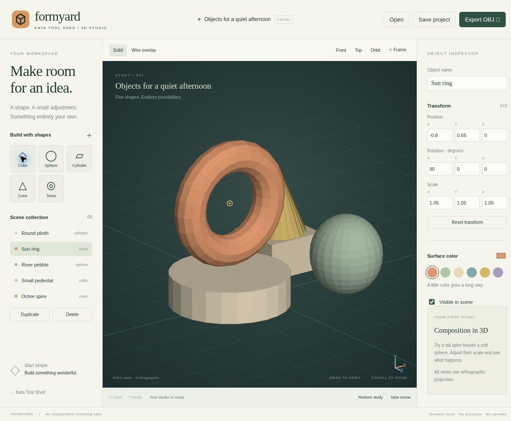
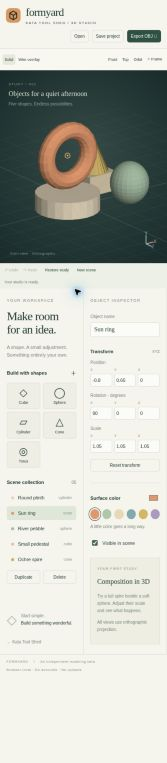

# Kata Formyard

**A little space for big ideas.** A local-first 3D primitive modeling studio inspired by Blender's approachable shape-and-transform workflow. Original code, artwork, and identity.

Part of [Kata Tool Shed](https://intrepion.github.io/tools/). Repository: `kata-app-inspired-by-blender-codex-dot`.

## Screenshots

Actual browser captures of the app served through localhost, not mockups.



<details><summary>390px narrow-screen layout</summary>



</details>

## Run locally

Node.js 18 or newer. No dependencies, package installation, remote fonts, or CDN assets.

```sh
npm run dev
```

Open `http://127.0.0.1:4311` (or the printed local server URL). Never open the HTML directly with `file://`. Change ports with `PORT=4315 npm run dev`; on PowerShell use `$env:PORT=4315; npm run dev`.

```sh
npm run check
npm run build
```

`check` runs JavaScript syntax checks and 15 Node tests. `build` creates a static `dist/` directory. Serve `dist/` with an HTTP server. The source server also provides `/tests/browser.html` for browser-native UI checks and `/tests/responsive.html` for a 390px iframe layout inspection. Test pages are excluded from the production build. `?test=1` disables reading/writing autosave for repeatable checks.

## Make something

1. Start with the original **Objects for a quiet afternoon** study, or choose **New scene**.
2. Add a cube, sphere, cylinder, cone, or torus. Select a shape from the scene collection or click its visible surface.
3. Edit XYZ position, rotation, and scale in the inspector. Give shapes names and colors, hide them, duplicate them, or delete them.
4. Drag the viewport to orbit, Shift/right-drag to pan, and scroll to zoom. Front, Top, Orbit, and Frame controls are available. All views use **orthographic** projection.
5. Download an editable `.formyard` project or export the visible objects as a geometry-only Wavefront `.obj` file.

## Keyboard and accessibility

- Ctrl/⌘ Z: undo. Ctrl/⌘ Shift Z: redo.
- Ctrl/⌘ S: download a project.
- F: frame the visible scene. Delete: remove the selected object.
- All scene and transform controls are keyboard-operable and labeled. Buttons expose selected states, and file errors/status updates have a live region.
- Narrow screens move the viewport above two tool panels so every control remains available.
- The 3D view is visual, not a full nonvisual modeling interface.

## Real capabilities and deliberate limits

This is a **functional small primitive modeler**, not Blender parity. Objects have actual 3D triangle geometry and independently editable transforms. Exported OBJ vertices reflect those transforms. The scene supports 40 objects and 30 in-memory undo snapshots. Rendering is CPU Canvas 2D with projected 3D triangles and simple directional lighting.

It does not include vertex/edge/face editing, extrude/bevel, modifiers, booleans, mesh import, UV editing, PBR materials, textures, rigs, animation, simulation, ray tracing, perspective projection, or Blender file compatibility. OBJ export contains geometry and object names, not colors, materials, or hidden objects. Intersecting surfaces can show painter-order artifacts because the renderer sorts triangles rather than using a depth buffer. No GPU or physical pen hardware is required.

## Persistence and privacy

No accounts, backend, upload, analytics, or external asset calls. A single latest project is autosaved in this origin's local storage. Autosave is best-effort and failure is reported. Browser cleanup, private mode, or using a different origin can remove or hide that autosave. **Download project files for durable backups.** History is in memory and resets on reload.

Opening another project, creating a new scene, or restoring the study asks before replacing edits not yet downloaded; replacement remains undoable. Imported projects validate format/version, object count, unique IDs, types, color, names, finite numeric transforms and limits. Project files are limited to 1 MB. Names render as text, not HTML.

## Structure

- `src/core.js`: original geometry, vector math, renderer, picking, history and OBJ export.
- `src/model.js`: scene definitions, validation and bounds.
- `src/app.js`: UI, keyboard/pointer input, local autosave and project operations.
- `tests/`: unit tests and browser-native UI/layout harnesses.
- `docs/INSPIRATION.md`: primary-source research and scope decisions.
- `docs/QA.md`: verification results and limitations.
- `app.json`: Tool Shed metadata and published app link.

## License and attribution

MIT, see [LICENSE](LICENSE). Inspired by [Blender](https://www.blender.org/), with no affiliation, endorsement, borrowed artwork or file compatibility. The combined `.gitignore` includes Windows, macOS, Linux/Unix, editor, build, dependency, secret and testing patterns.


## Published app

Open [Kata Formyard](https://intrepion.github.io/kata-app-inspired-by-blender-codex-dot/). The public repository uses GitHub Actions to verify and deploy `dist/` from `main`. See [QA notes](docs/QA.md) for local verification and known limits.
